# 🔐 WEEK 3 – PASSWORD CRACKING PRACTICAL
### Cybersecurity & Ethical Hacking | Password Security and Hash Analysis

---

# 📌 PROJECT OVERVIEW

This repository contains the documentation for the Week 3 Cybersecurity and Ethical Hacking practical exercises.

The exercises focused on password cracking, password hash extraction, and password recovery from encrypted PDF documents.

Two practical modules were completed using different password-cracking approaches:

- **Project Module 1:** Password Cracking with John the Ripper (JTR) and Johnny GUI.
- **Project Module 2:** Password Cracking with Networkwalks Tools.

For Module 1, three separate password-protected PDF documents were processed using John the Ripper. Each document produced an individual password-cracking result.

Module 2 introduced the use of Networkwalks online tools to extract PDF password hashes and attempt password recovery.

The practical exercises provided hands-on experience with password security, hash extraction, and the importance of strong password protection.

---

# 🎯 PROJECT OBJECTIVES

The objectives of these practical exercises were to:

- Understand password cracking and password hashing.
- Identify how password-protected PDF documents are secured.
- Extract password hashes from encrypted PDF files.
- Install and configure John the Ripper and Johnny GUI.
- Use John the Ripper to perform password-cracking attacks.
- Use Networkwalks tools to extract and crack PDF hashes.
- Verify recovered passwords by opening protected PDF documents.
- Understand the importance of strong and unique passwords.

---

# 🛠️ TOOLS AND TECHNOLOGIES

| Tool | Purpose |
|---|---|
| John the Ripper | Password-cracking software |
| Johnny GUI | Graphical interface for John the Ripper |
| PDF Hash Extractor | Extracts hashes from protected PDF documents |
| Notepad | Saves extracted hash values |
| Networkwalks Hash Calculator | Generates PDF password hashes |
| Networkwalks Password Cracker | Attempts password recovery |
| Windows PC | Operating environment |
| Web Browser | Accesses online tools |

## 🔗 TOOL REFERENCES

- [John the Ripper Official Website](https://www.openwall.com/john/)
- [Johnny GUI](https://openwall.info/wiki/john/johnny)
- [Online PDF Hash Extractor](https://www.onlinehashcrack.com/tools-pdf-hash-extractor.php)
- [Networkwalks Practical Lab](https://networkwalks.com/project-task-lab-password-cracking-with-networkwalks-tools/)
- [Networkwalks Hash Calculator](https://networkwalks.com/hash-calculator/)
- [Networkwalks Password Cracker](https://networkwalks.com/password-cracker/)

---

# 🔵 PROJECT MODULE 1: PASSWORD CRACKING WITH JOHN THE RIPPER

## 1.1 Background

John the Ripper (JTR) is a password-cracking tool commonly used by cybersecurity professionals to evaluate password strength.

It supports different password hash formats and can be used to test the security of password-protected files, including PDF documents.

Johnny is the graphical user interface for John the Ripper. It provides a more accessible way to interact with JTR without relying entirely on command-line instructions.

This practical involved using both John the Ripper and Johnny GUI to recover passwords from three separate protected PDF documents.

## 1.2 Task

Use John the Ripper and Johnny GUI on a Windows PC to crack the passwords of three protected PDF documents:

1. lockedpdf1
2. lockedpdf2
3. lockedpdf3

Each document was processed separately, and the results were documented individually.

---

## 1.3 PROCEDURE AND IMPLEMENTATION

### STEP 1 – Download John the Ripper

John the Ripper was downloaded from the official Openwall website.

The downloaded files were extracted to the computer in preparation for installation and configuration.

---

### STEP 2 – Download and Install Johnny GUI

Johnny GUI was downloaded from the official website.

The installation file was opened, and the setup instructions were followed to complete the installation.

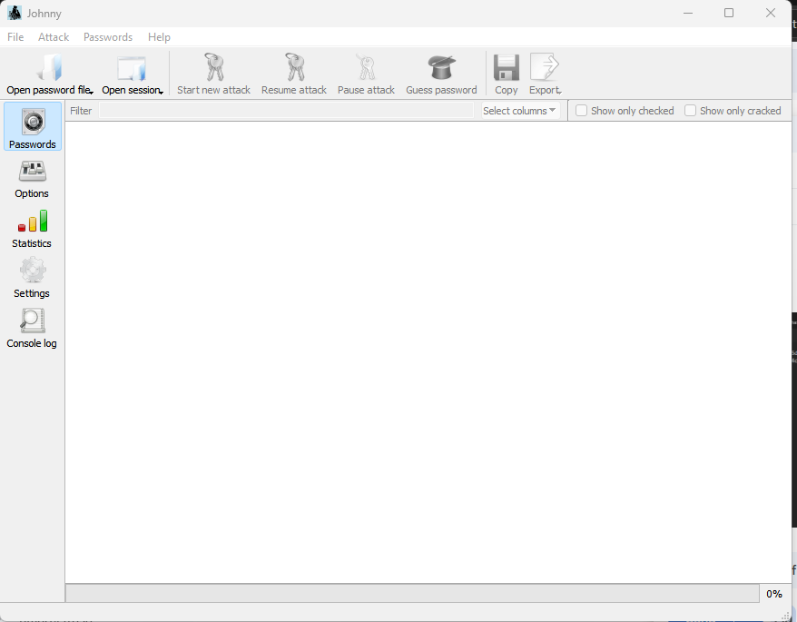

---

### STEP 3 – Configure Johnny GUI

After installation, Johnny was opened.

The settings option was selected to configure the application and locate the John the Ripper executable.

The `john.exe` file was located inside the `run` folder within the extracted John the Ripper directory.

The executable was selected to allow Johnny to communicate with John the Ripper.

**Screenshot 6 – Johnny Settings**

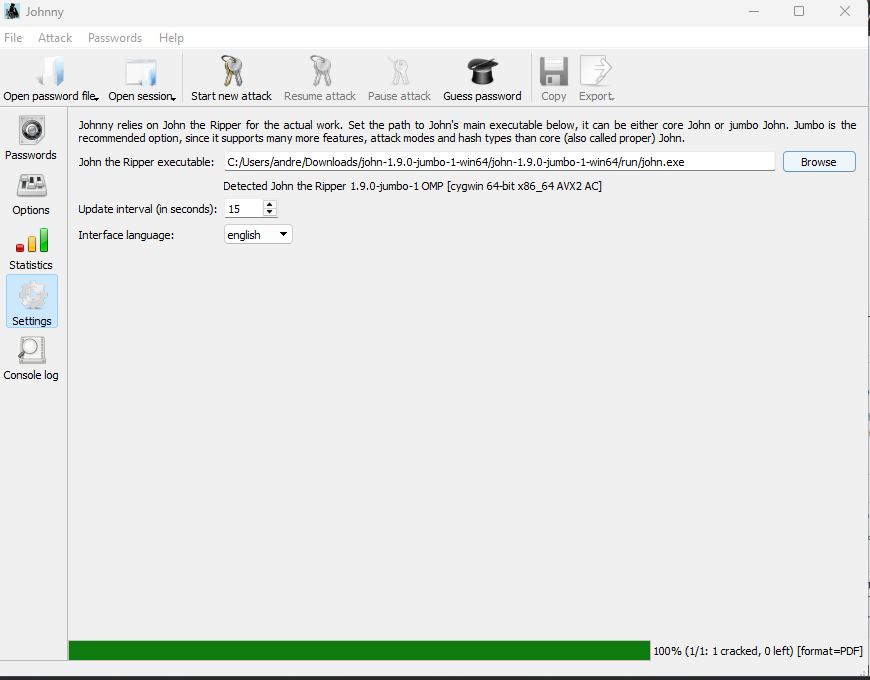

**Screenshot 7 – Locating john.exe**

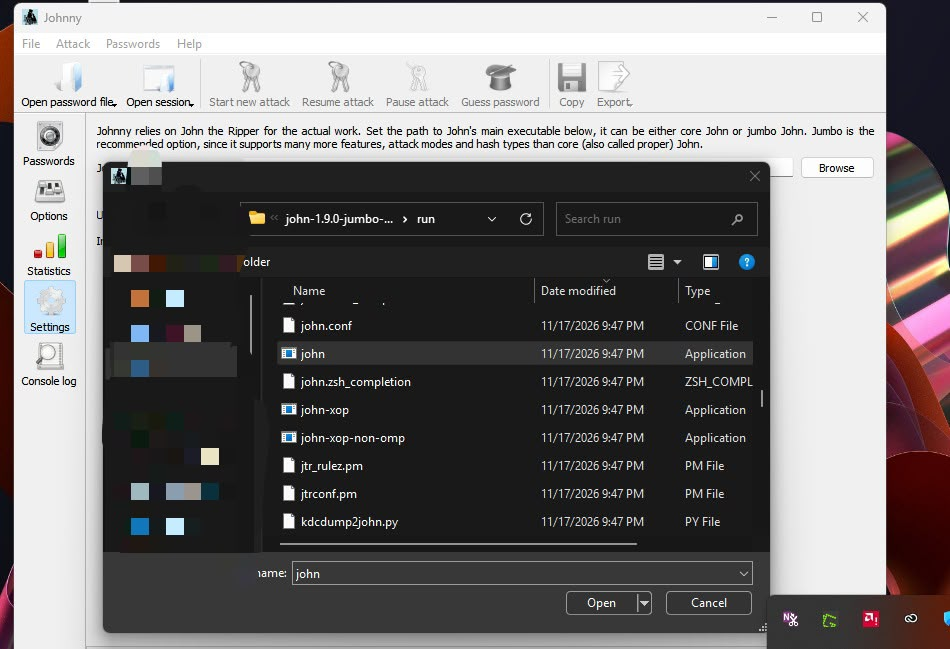

**Screenshot 8 – John Executable Selected**

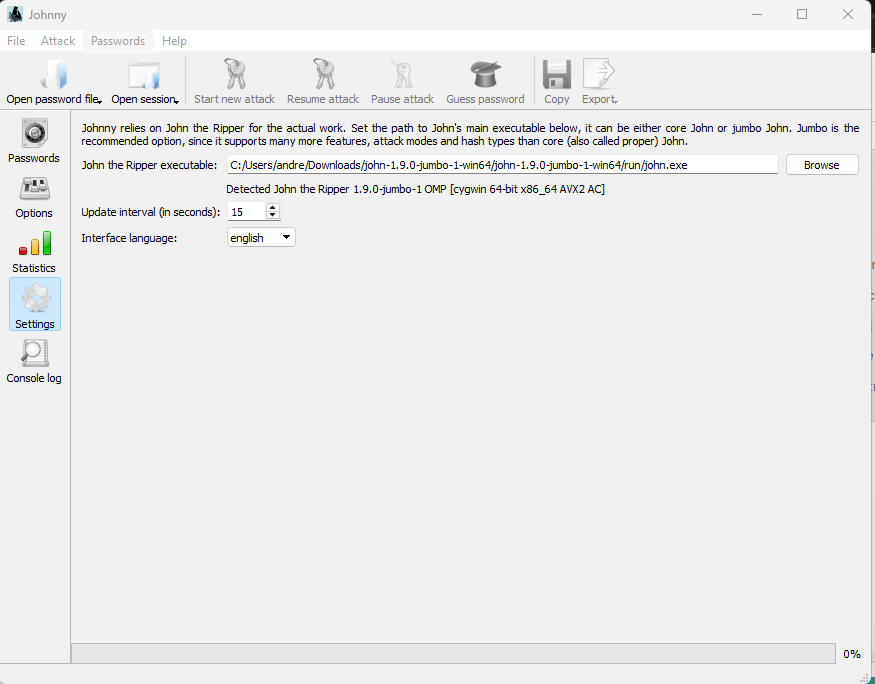

---

### STEP 4 – Download the Protected PDF Documents

Three password-protected PDF documents were selected for the exercise.

The documents were saved locally before beginning the hash extraction process.

**Screenshot 9 – First Protected PDF**

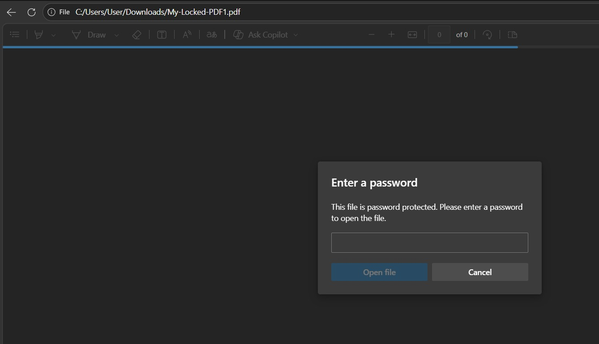

**Screenshot 10 – Second Protected PDF**

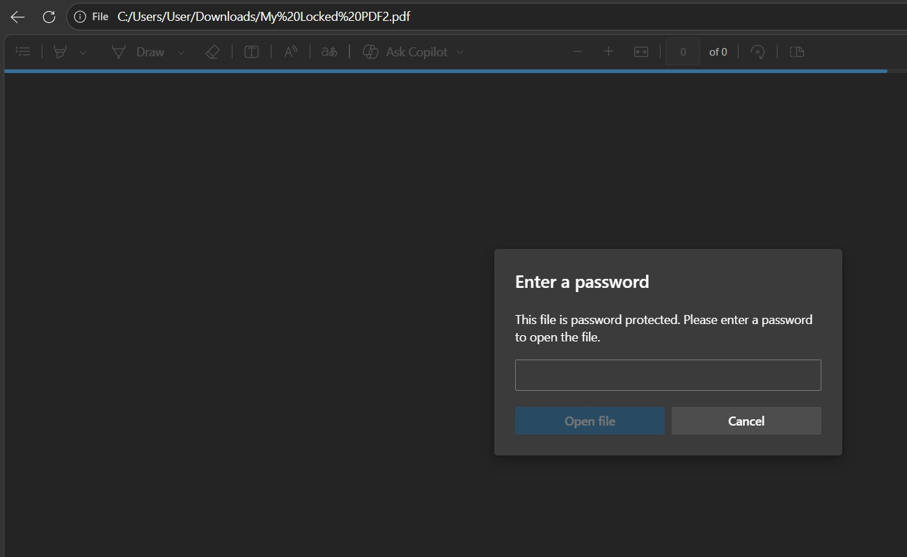

**Screenshot 11 – Third Protected PDF**

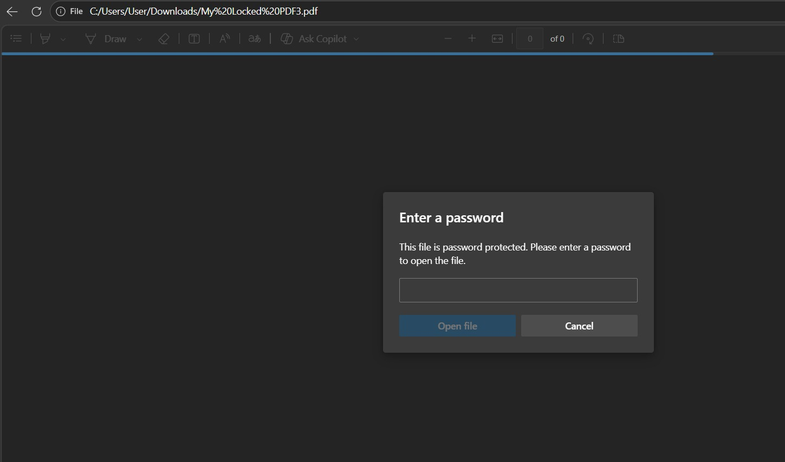

---

### STEP 5 – Extract the PDF Password Hashes

The Online PDF Hash Extractor was accessed through a web browser.

Each protected PDF document was uploaded individually to extract its corresponding password hash.

The extracted hash values were copied for use in John the Ripper.

The hash values were expected to begin with `$pdf$`.

**Screenshot 12 – PDF Hash Extractor Website**

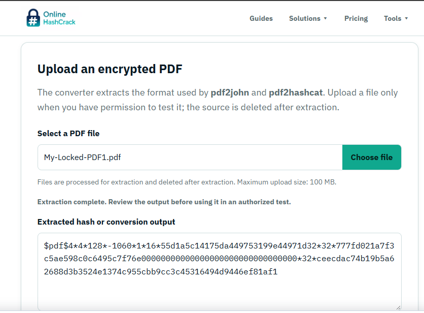

---

### STEP 6 – Save the Extracted Hash Values

Notepad was opened to store the extracted hash values.

Each hash was saved in a text file for use in the cracking process.

The first hash file was saved as `hash1.txt`. Separate files were prepared for the other PDF documents to keep the results organized.

**Screenshot 17 – Hash Pasted into Notepad**

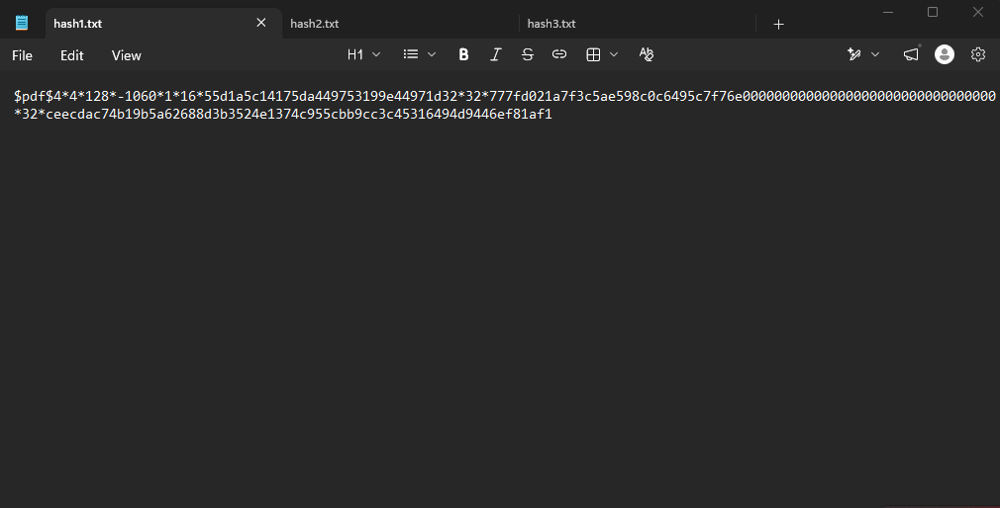

---

### STEP 7 – Import Hash Files into Johnny

Johnny was reopened.

The Open Password File option was selected, and the saved hash text file was imported.

This process was repeated for each of the three PDF documents.

**Screenshot 21 – Open Password File**

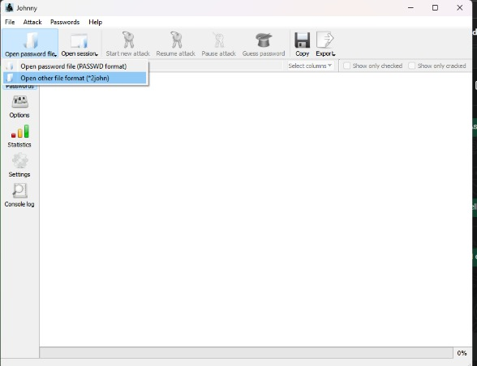

---

### STEP 8 – Start the Password-Cracking Attack

After importing each hash file, the Start New Attack option was selected.

John the Ripper began processing the hash and attempting to recover the corresponding password.

The process was performed separately for each PDF document.

The time required depended on the computer's processing speed and the complexity of the password.

**Screenshot 25 – Starting Attack on lockedpdf1**

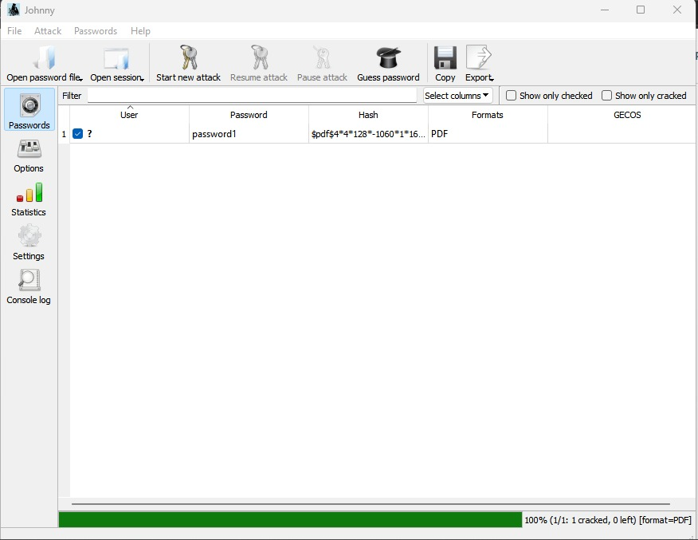

---

## 1.4 RESULTS AND SCREENSHOTS

The three protected PDF documents were processed individually using John the Ripper.

Each document produced a different password-cracking result.

The screenshots below provide placeholders for the individual results obtained during the practical.

### RESULT 1 – lockedpdf1

**Description:** Password-cracking result for the first protected PDF document.

**Screenshot:**

**PDF Verification:**

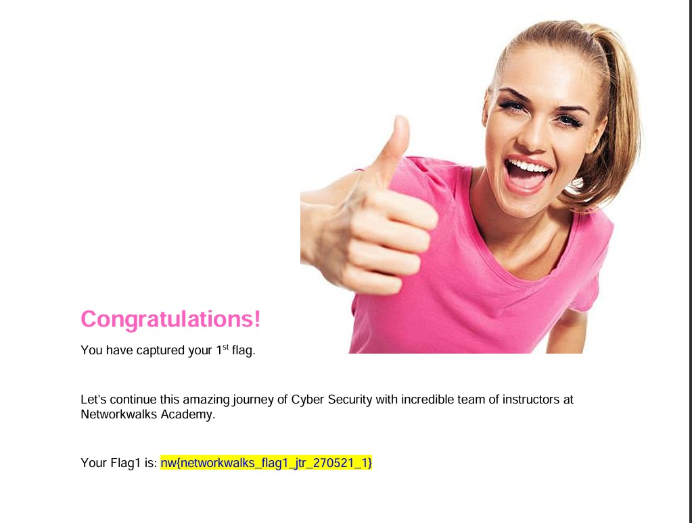

---

### RESULT 2 – lockedpdf2

**Description:** Password-cracking result for the second protected PDF document.

**Screenshot:**

**PDF Verification:**

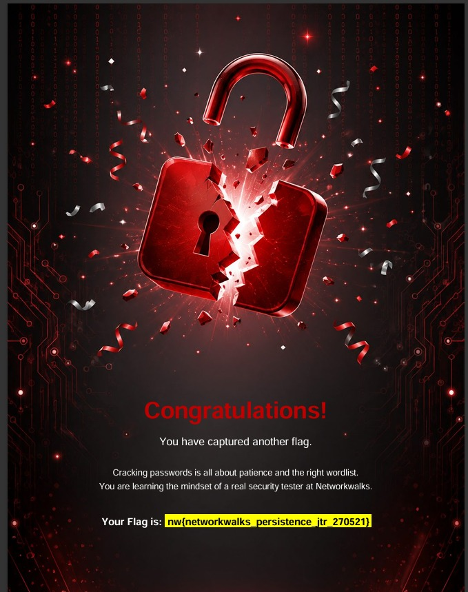

---

### RESULT 3 – lockedpdf3

**Description:** Password-cracking result for the third protected PDF document.

**Screenshot:**

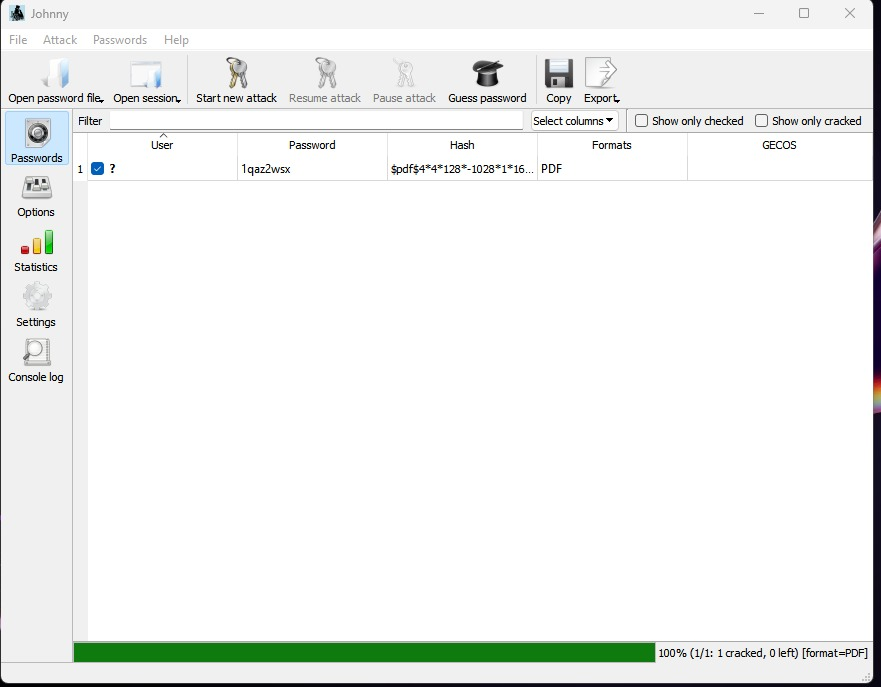

**PDF Verification:**

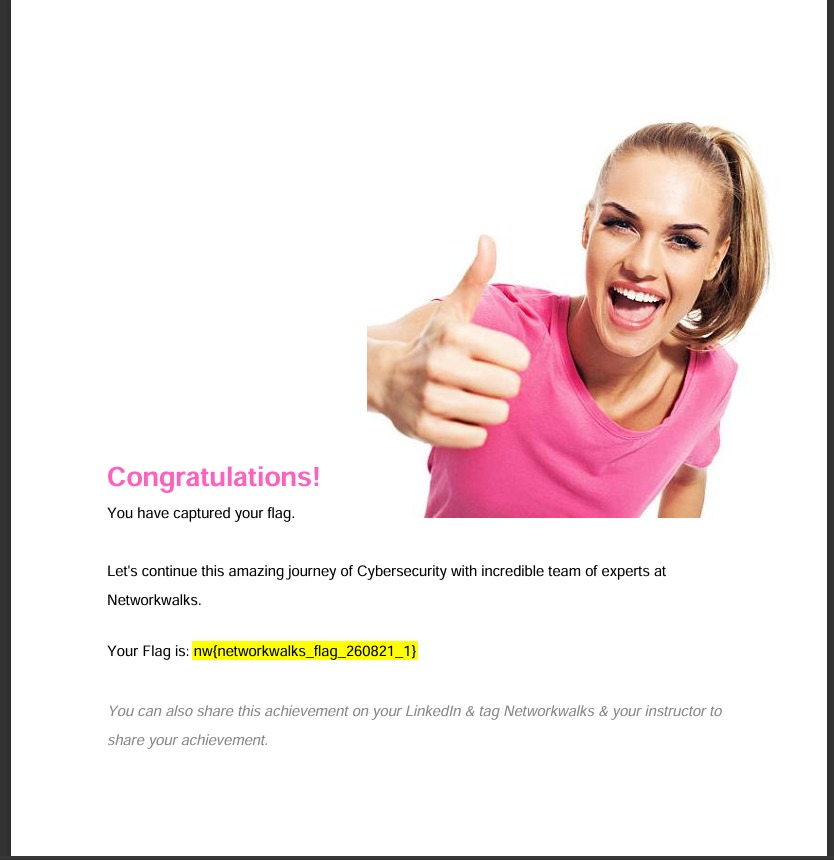

---

## 1.5 MODULE 1 SUMMARY

The first module provided practical experience using John the Ripper and Johnny GUI to recover passwords from encrypted PDF documents.

Three separate PDF files were processed, with individual hash extraction, import, cracking, and result verification.

The exercise demonstrated how password hashes can be extracted and used in password-cracking tools to evaluate the strength of document passwords.

---

# 🌐 MODULE 2: PASSWORD CRACKING WITH NETWORKWALKS TOOLS

## 2.1 Introduction

This practical involved using Networkwalks online tools to extract password hashes from an encrypted PDF and perform a password-cracking attempt.

## 2.2 Tools Used

- Networkwalks Hash Calculator
- Networkwalks Password Cracker
- Encrypted PDF document

## 2.3 Practical Procedure

1. Accessed the encrypted PDF document provided for the practical.
2. Used the Networkwalks Hash Calculator to extract the PDF password hash.
3. Copied the generated hash into the Networkwalks Password Cracker.
4. Initiated the cracking process and reviewed the results.
5. Used the recovered password to verify access to the PDF document.

## 2.4 Results

📸 **Screenshot 1 – PDF Hash Extraction**

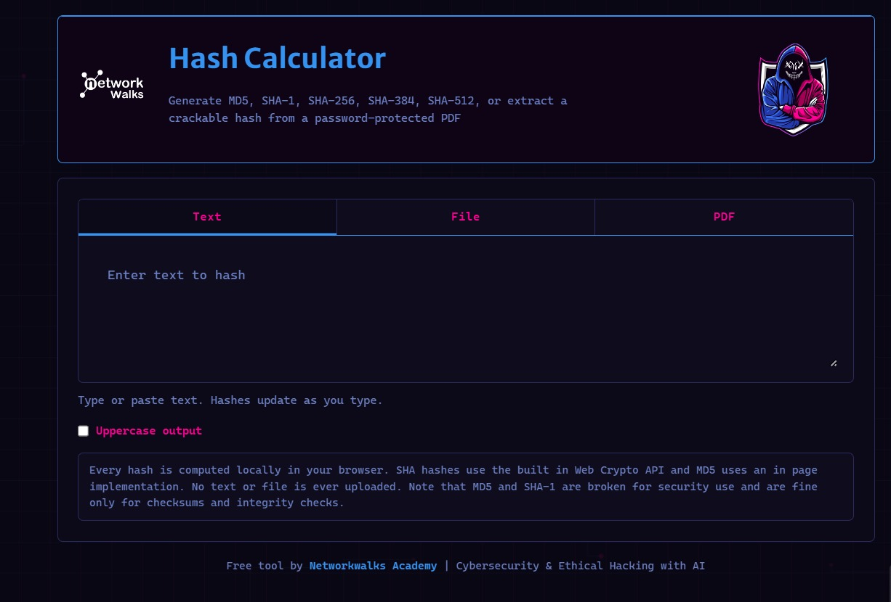

📸 **Screenshot 2 – Password Cracking Process**

📸 **Screenshot 3 – Final Results**

# 📚 KEY LEARNINGS

The Week 3 practical exercises provided hands-on experience in password security and password-cracking techniques.

The main lessons learned include:

### 1. Password Hashing
Developed an understanding of how passwords are represented through cryptographic hashes.

### 2. Hash Extraction
Learned how to extract password hashes from encrypted PDF documents using online tools.

### 3. John the Ripper
Gained practical experience installing, configuring, and using John the Ripper with Johnny GUI.

### 4. Password Cracking
Learned how password-cracking tools process hashes and attempt to identify the original password.

### 5. Networkwalks Tools
Gained experience using online tools to calculate PDF hashes and attempt password recovery.

### 6. Password Verification
Understood the importance of testing recovered passwords against the original protected documents.

### 7. Password Security
Recognized the importance of strong, unique, and complex passwords in protecting sensitive information.

---

# 🔒 SECURITY RECOMMENDATIONS

Based on the exercises completed, the following security practices are recommended:

- Use long and complex passwords.
- Avoid common words and predictable password combinations.
- Use unique passwords for different accounts and documents.
- Consider using a reputable password manager.
- Protect sensitive documents with strong encryption.
- Avoid sharing passwords and password hashes with unauthorized individuals.
- Use multi-factor authentication where available.
- Regularly review password security practices.

---

# 📝 CONCLUSION

The Week 3 practical exercises provided valuable hands-on experience in password cracking, hash extraction, and password security.

The first module focused on using John the Ripper and Johnny GUI to process three separate password-protected PDF documents. Each document was handled individually, producing three different password-cracking results.

The second module introduced Networkwalks online tools, demonstrating how PDF password hashes can be extracted and submitted for password recovery.

Overall, the exercises strengthened my understanding of password protection, hash analysis, and the methods used by cybersecurity professionals to evaluate password security.

The practical activities also highlighted the importance of creating strong passwords to reduce the risk of unauthorized access.

---

# ⚠️ DISCLAIMER

These practical exercises were conducted for educational purposes as part of cybersecurity and ethical hacking training.

Password-cracking tools should only be used on files, systems, and resources that you own or have explicit authorization to test.

---

## ✅ WEEK 3 PRACTICAL COMPLETED

**Modules Completed:**
- Module 1 – Password Cracking with John the Ripper
- Module 2 – Password Cracking with Networkwalks Tools

**Main Focus Areas:**
Password Cracking | Hash Extraction | Hash Analysis | Password Recovery | Cybersecurity | Ethical Hacking

